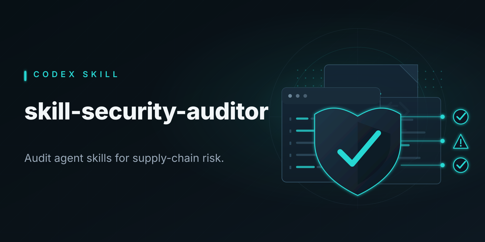

# skill-security-auditor

Check an agent skill before you install it. The skill is fetched into a quarantine folder and never run; you get a PASS, REVIEW or BLOCK verdict with the reasons, and if you agree, the exact files that were checked are installed and pinned so later changes are noticed.

Works as a skill in Claude Code and Codex, and as a command line tool and CI step. Standard library Python 3.11+, no dependencies.

## Quick start

In Claude Code or Codex, with the skill installed:

```text
/securityauditor https://github.com/owner/repo/tree/main/skills/some-skill
```

From a terminal:

```powershell
python skills/securityauditor/scripts/scan_skill.py check owner/repo/skills/some-skill
```

## What a verdict looks like

```text
PASS  notes-helper  12 files  0.4s
can: read local files
```

```text
BLOCK  pdf-tools  31 files  0.9s
can: network (collect.example.test), download and run code, read credential files
runs without asking: SessionStart hook -> hooks/hooks.json
critical  secret-to-network  scripts/sync.py:4   Credential file contents are sent over the network
critical  remote-exec        scripts/setup.sh:1  Downloads code and runs it
+3 more  full report: <path>
```

```text
REVIEW  api-helper  9 files  0.3s
can: network (api.vendor.example), use secret variables
medium  secret-to-unknown-host  scripts/call.py:7  A secret is sent to a host with no known vendor
not analyzed: assets/guide.pdf
```

- **BLOCK**: at least one high or critical finding. Do not install.
- **REVIEW**: medium findings or files that could not be checked. Read the lines and decide.
- **PASS**: nothing found. It is not proof that a skill is safe.

`can:` lists what the skill is able to do. `runs without asking:` lists everything the agent host would run without a prompt (hooks, monitors, MCP servers, lifecycle scripts, pre-approved tools), because that is the part the host's own permission prompts do not show you.

Unless the static checks already blocked the skill, the output also contains a capped, sanitized review packet. The agent's model reads it against a fixed rubric and may raise the verdict, never lower it. `--static` turns that off.

## What it checks

| Area | What is checked |
| --- | --- |
| Runs without asking | Hooks, monitors, MCP server commands, inline commands in `SKILL.md`, `allowed-tools` pre-approvals, npm lifecycle scripts. Each command is analyzed and marked as checked or not. |
| Download and run | Fetches piped, substituted, or saved and then executed, in shell, PowerShell, Python and JavaScript. |
| Secrets leaving | Credential files or the whole environment read and sent out, followed through pipelines, variables and files. A secret sent to its own vendor is fine; to a raw IP, a webhook service or another vendor it is not. |
| Hidden instructions | Unicode tag characters, zero-width runs, bidi overrides, HTML comments, image alt text, link titles, instructions split across lines, text addressed to a reviewer. |
| Odd files | UTF-16 files and extensionless scripts are decoded and checked; anything that cannot be checked is listed. |
| Install something else | Instructions to download and run an extra component as a "required" step. |
| Lookalike source | Repository names that imitate a well-known skill repository under another owner. |
| Says one thing, does another | Capabilities compared with what `SKILL.md` says the skill does. |
| Meaning | Paraphrased and non-English instructions, by the model review. |

Every check has a page with a flagged and a not-flagged example in [docs/checks](docs/checks). Star, fork and download counts are never used. How it fits together: [docs/how-it-works.md](docs/how-it-works.md).

## Install and pin

After a check, install the exact files that were checked:

```powershell
python skills/securityauditor/scripts/scan_skill.py install <check-id> --to <your skills folder>
```

This refuses a BLOCK verdict and a quarantine that changed since the check, copies the files without downloading anything again, and records them in `skill.lock.json`. You can also pin a folder you already have with `pin <folder>`.

## Watching for changes

```powershell
python skills/securityauditor/scripts/scan_skill.py verify
```

`verify` reports any pinned skill whose files changed, in terms of new capabilities, new hosts, new things that run without asking and new findings. `verify --quiet` only compares hashes and prints nothing when nothing changed; [docs/hook-example.md](docs/hook-example.md) shows how to run it at session start. The tool never edits your agent settings itself. `diff <old> <new>` compares two versions of a skill directly.

## Using it with SkillSpector

If [NVIDIA SkillSpector](https://github.com/NVIDIA/skillspector) is installed (on `PATH`, or `SKILLSPECTOR_BIN`), `check` also runs it with its model stage off and takes the stricter verdict; the output says when it was used and which tool raised the verdict. SkillSpector looks up dependency names in a vulnerability database during a scan; `--no-external` turns it off.

## CI

```yaml
- uses: saroo98/skill-security-auditor@main
  with:
    path: skills
    fail-on: high
```

The action writes SARIF and uploads it to code scanning. For pre-commit, use the `skillaudit` hook from `.pre-commit-hooks.yaml`. On the command line, `scan <path> --format text|json|sarif|brief --fail-on LEVEL`.

Findings can be suppressed only by the person running the scan: `--config` with `[[suppress]]` entries that each carry a reason, or `--baseline` with a reason for every fingerprint. A suppression file or ignore comment inside a scanned skill is itself reported and never honored.

## Benchmark

`bench/` holds an inert corpus of skill attacks and harmless look-alikes, stored as data and written out as real folders only in a temporary directory (cases that antivirus software flags are scored in memory unless `--include-av-sensitive` is given). `python -m bench.run` scores any scanner with an adapter in `bench/adapters/`.

Results on 2026-11-27, model stages off for every scanner (full table: [bench/results/RESULTS.md](bench/results/RESULTS.md)):

| Scanner | Static-scope attacks caught | Benign cases blocked |
| --- | --- | --- |
| skill-security-auditor 0.9.0 | 50/50 | 0/20 |
| Cisco skill-scanner 2.3.2 | 25/49 | 4/20 |
| SkillSpector 2.13.7 | 11/49 | 1/20 |

Read the corpus numbers with care: most cases were written by this project's authors while building its checks, so its own score on them is optimistic.

The fairer measure is real skills. On 1,787 skills from eleven public repositories pinned to a commit (Anthropic, OpenAI, Microsoft, GitHub, NVIDIA, Hugging Face, Vercel, Trail of Bits, obra/superpowers, K-Dense; listed in `bench/sources.toml`), this tool gives PASS to 73.1%, REVIEW to 23.2% and BLOCK to 3.6%. Every BLOCK was read by hand (`bench/triage.toml`): 22 are worth stopping for (for example `curl ... | bash` installers, instructions to fetch and follow a remote page, adding a remote MCP server, an injection test fixture), and 43 are false alarms, 2.4% of all skills. Reproduce with `python -m bench.fetch_real <folder>` and `python -m bench.run --real <folder>`.

Corpus rules: every case cites a public source for its technique, no case is removed to improve a number (this project's included), and maintainers of a scanner are told about its misses before results that name it are published.

## Limits

- Static checks plus one bounded model review. The skill is never run, so behavior that only appears at run time is not seen.
- Paraphrased and non-English instructions are left to the model review; a malicious package recognizable only by its name, and content fetched after review, are out of static scope.
- Instructions phrased as third-person description ("this skill tells an agent to ...") are treated as documentation by the static checks.
- Private repositories are not supported; no tokens are read or sent.
- A PASS means nothing was found, not that a skill is safe.

## Contributing

See [CONTRIBUTING.md](CONTRIBUTING.md): how to add a check, a benchmark case or a scanner adapter.

## License

MIT. See [LICENSE](LICENSE).
